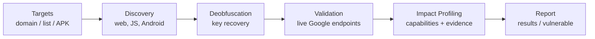

<h1 align="center">
  
</h1>

<p align="center">
  <b>Google Gemini and Google API key discovery and security assessment tool.</b>
</p>

<p align="center">
  <a href="https://github.com/defaultsecc/GeminiHunter/stargazers"></a>
  <a href="https://github.com/defaultsecc/GeminiHunter/issues"></a>
  <a href="https://github.com/defaultsecc/GeminiHunter/forks"></a>
  
  
  
  
</p>

<p align="center">
  <a href="#overview">Overview</a> •
  <a href="#features">Features</a> •
  <a href="#installation">Installation</a> •
  <a href="#usage">Usage</a> •
  <a href="#bulk-domain-input-via-chaos">Chaos Integration</a> •
  <a href="#android-scanning">Android</a> •
  <a href="#output-files">Output</a> •
  <a href="#responsible-use">Responsible Use</a>
</p>

---

## Overview

GeminiHunter crawls web assets and Android packages for exposed Google API keys
(the `AIza...` family), recovers keys hidden through common obfuscation, validates
them against live Google endpoints, and profiles what an exposed key can do so its
impact can be assessed and reported.

> [!WARNING]
> **Authorized use only.** This tool is for penetration tests, permitted bug bounty
> programs, and assets you own or have written permission to test. Scanning without
> authorization may be illegal. See [Responsible Use](#responsible-use).



## Features

- **Web scanning** of a single target or a bulk list, including linked JavaScript.
- **Android scanning** for `.apk`, `.xapk`, and `.apks` packages (jadx when available,
  with a hardened archive and binary-string fallback when it is not).
- **Obfuscation recovery**: concatenated strings, character arrays, reversed
  strings, hex and unicode escapes, and Base64 values.
- **Key validation** against live Google endpoints, including a Referer-based
  restriction bypass check.
- **Capability and impact profiling** for confirmed keys, with evidence saved to disk.

## Requirements

| Component | Requirement |
| --- | --- |
| Python | 3.8 or newer |
| Python packages | `requests`, `colorama`, `urllib3`, `tqdm` |
| Optional | `jadx` on PATH for deep Android decompilation |
| Optional | `ffmpeg` on PATH for audio evidence conversion during capability analysis |

## Installation

```bash
git clone https://github.com/defaultsecc/GeminiHunter.git
cd GeminiHunter

python3 -m venv .venv
source .venv/bin/activate

pip install requests colorama urllib3 tqdm
```

Optional components (Debian / Ubuntu / Kali):

```bash
sudo apt install jadx ffmpeg
```

## Usage

### Interactive menu

Run with no arguments:

```bash
python3 geminihunter.py
```

| # | Module | Purpose |
| --- | --- | --- |
| 1 | Recon Sweep | Scan a single target |
| 2 | Mass Recon | Scan a list of targets |
| 3 | Source Inspector | Scan a list of JavaScript URLs |
| 4 | Android Inspector | Scan APK / XAPK / APKS packages |
| 5 | Credential Probe | Validate discovered keys |
| 6 | Impact Profiler | Capability analysis of confirmed keys |
| 7 | Terminate | Exit |

### Command line

```bash
python3 geminihunter.py -t example.com                              # single target
python3 geminihunter.py -f targets.txt -o results.txt               # bulk list
python3 geminihunter.py -a application.apk                          # android package
python3 geminihunter.py -l results.txt --verify -o vulnerable.txt   # validate keys
```

### Command-line options

| Option | Argument | Description |
| --- | --- | --- |
| `-t`, `--target` | domain or URL | Scan a single target. |
| `-f`, `--file` | file path | Scan a list of targets, one per line. |
| `-a`, `--apk` | file path | Scan an APK, XAPK, or APKS package. |
| `-l`, `--list` | file path | File of API keys to validate. |
| `--verify` | | Enable key validation mode. |
| `-o`, `--output` | file path | Output file (default `results.txt`). |
| `--timeout` | seconds | Per-request timeout (default `8`). |
| `-q`, `--quiet` | | Reduce terminal output. |

Target files take one domain or URL per line. Lines starting with `#` are ignored.

## Bulk Domain Input via Chaos

A ready-made domain list can be downloaded from the
[Chaos dataset](https://chaos.projectdiscovery.io/) and passed straight to GeminiHunter.

```bash
# 1. Download a program's dataset from the Chaos site (within your scope),
#    then extract it into a single target list:
unzip program.zip -d chaos_targets
cat chaos_targets/*.txt | sort -u > targets.txt

# 2. Scan the targets for exposed keys:
python3 geminihunter.py -f targets.txt -o results.txt

# 3. Validate anything found:
python3 geminihunter.py -l results.txt --verify -o vulnerable.txt
```

> [!NOTE]
> Only use domain lists that correspond to targets you are authorized to assess.

## Android Scanning

The Android Inspector takes a local `.apk`, `.xapk`, or `.apks` file. The tool does
not download apps.

- **With jadx installed:** packages are decompiled so code and decoded resources are scanned.
- **Without jadx:** a read-only archive walk decodes text members and runs string
  extraction over binary members (`classes.dex`, native libraries, compiled resources).
- **Bundles:** XAPK and APKS files are unpacked and their inner APKs scanned.
- **Safety:** archive handling rejects path-traversal and symlink entries and caps
  entry count and size.

## Output Files

| File | Contents |
| --- | --- |
| `results.txt` (or `-o` value) | Discovered keys with origin and source |
| `vulnerable.txt` | Confirmed keys from validation |
| Output directories | Evidence and reports from capability analysis |

## Responsible Use

GeminiHunter is built for authorized security testing and educational purposes.

- Test only assets you own or have explicit written permission to assess.
- Any keys recovered are **real credentials belonging to their owners**. Handle them
  only within the terms of your engagement.
- Follow responsible disclosure: report findings to the affected owner or program
  and do not retain or misuse recovered keys.
- You are responsible for your use of this tool.

## Disclaimer

This software is provided for authorized security testing and educational purposes
only. The authors accept no liability for misuse or damage. By using it you confirm
you have permission to test the targets you provide and accept full responsibility
for your actions.

## License

See the `LICENSE` file in the repository. If none is present, all rights are reserved
by the repository owner until one is added.
